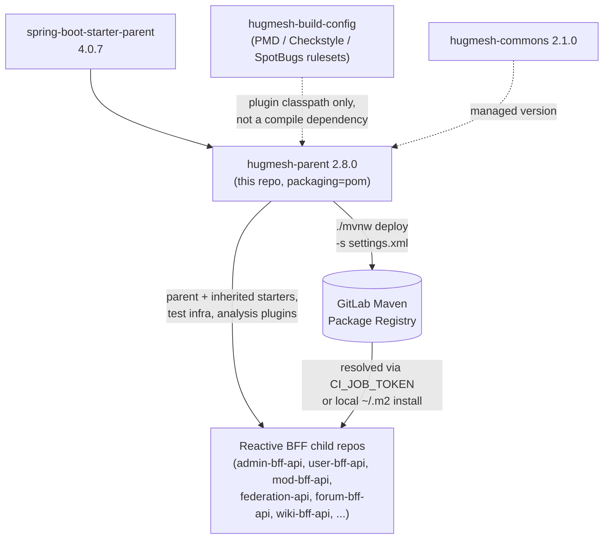

# hugmesh-parent

The HugMesh ecosystem **metapom** (`packaging=pom`). It consolidates the shared
Spring Boot 4.0.7 / Spring Cloud 2025.1.2 / Java 25 reactive-BFF baseline so every
service repo inherits one audited set of starters, versions, plugins, and publishing
config instead of copying them.

## Coordinates

```
groupId:    systems.hugmesh
artifactId: hugmesh-parent
version:    2.8.0
packaging:  pom
```

Itself a child of `org.springframework.boot:spring-boot-starter-parent:4.0.7`.

This is the **2.8.0 / Boot-4 line**. The legacy **1.0.0 / Spring Boot 3.5.5 line**
stays untouched for any BFF that has not yet migrated, but all new and migrated
services target 2.8.0.

## What it provides

- **Properties:** `java.version=25`, UTF-8 encoding, and pinned versions for
  `hugmesh-commons` (2.1.0), the Spring Cloud release train (2025.1.2), SpringDoc
  (3.0.3, the Boot-4 / Spring Framework 7 line), Resilience4j (2.4.0, the Boot-4
  starter line), and the AWS SDK BOM (2.28.3).
- **Common dependencies** (inherited by every reactive BFF): WebFlux, Actuator,
  Security, OAuth2 Resource Server, Validation, Data-R2DBC + r2dbc-postgresql,
  Liquibase (+ `spring-boot-liquibase` runtime module — Boot 4 split
  `LiquibaseAutoConfiguration` out of the core autoconfigure umbrella, so without it
  migrations silently never run), spring-jdbc + postgresql (runtime), SpringDoc
  WebFlux UI; plus the test stack (spring-boot-starter-test, reactor-test,
  spring-security-test, r2dbc-h2, h2, the Boot-4 split test-slice modules
  `spring-boot-webflux-test` / `spring-boot-data-r2dbc-test`, and the Testcontainers
  integration-test infra `spring-boot-testcontainers` + testcontainers-postgresql/testcontainers-junit-jupiter/testcontainers-r2dbc).
- **dependencyManagement:** the Spring Cloud `spring-cloud-dependencies` BOM (import),
  `hugmesh-commons`, AWS SDK BOM (import), Resilience4j
  (`resilience4j-spring-boot4` + `resilience4j-reactor`), SpringDoc, the
  Testcontainers BOM (import), plus deliberate **H2 pins** (`r2dbc-h2 1.0.0.RELEASE` /
  `h2 2.3.232`) that override Boot 4's managed versions, whose combination regressed
  parameter binding for the H2 `@DataR2dbcTest` slices — children declare all of these
  without a `<version>`.
- **pluginManagement:** compiler, surefire (with the Byte Buddy
  `-Dnet.bytebuddy.experimental=true` flag for newer JDKs), spring-boot-maven-plugin,
  native-maven-plugin (GraalVM).
- **Inherited static-analysis enforcement** (`<build><plugins>`, runs in every Java
  child, no-op on this pom parent): PMD, Checkstyle and SpotBugs+FindSecBugs wire the
  org's secure/clean-Java + reactive-readability conventions and **fail the build on
  violations** (`:check` goals; `failOnViolation=true` for PMD/Checkstyle,
  `failOnError=true` for SpotBugs). See the section below.
- **`aspectjweaver`** is included in the dependency set so that `@CircuitBreaker` and
  other Spring AOP annotations from Resilience4j wire automatically across all child
  repos without any per-repo AspectJ configuration.
- **distributionManagement:** the GitLab project Maven Package Registry.

## Static-analysis enforcement (inherited, fail-mode)

Every Java repo that parents off this metapom automatically runs three analysers on
`verify` — the child declares nothing. The curated rulesets are NOT in this repo; they
ship in the resource-only **`systems.hugmesh:hugmesh-build-config`** jar and are
referenced on each plugin's own classpath (PMD `/hugmesh/*.xml`, Checkstyle/SpotBugs
`hugmesh/*.xml`). That is the only mechanism by which a separate repo can see a
ruleset that physically lives elsewhere, and it gives curated rules + automatic
inheritance with one new artifact.

| Plugin | Conventions | Rules | Output |
|--------|-------------|-------|--------|
| `maven-pmd-plugin` | **A**, **B** | `FinalFieldCouldBeStatic`, `ImmutableField` | `target/pmd.xml` |
| `maven-checkstyle-plugin` | **F**, **G**, **H** | `VisibilityModifier`, `FinalClass`, `HideUtilityClassConstructor`, `MutableException`, `LambdaBodyLength` | `target/checkstyle-result.xml` |
| `spotbugs-maven-plugin` + FindSecBugs | **D**, **E** | `EI_EXPOSE_REP*`, `MS_EXPOSE_REP`, `MS_MUTABLE_*`, `MS_SHOULD_BE_FINAL` (include-filtered) | `target/spotbugsXml.xml` |

Convention **C** (enum for fixed string sets) and the *defensive-copy fix* /
*lambda→method-ref* / *nesting* halves of D and H have no reliable low-noise static
rule, so they remain agent-pass conventions — by design, no rule is added that would
flag every lambda or every collection field.

**Fail-mode.** All three run in CHECK mode via the `:check` goal (`pmd:check`,
`checkstyle:check`, `spotbugs:check`), not the reporting-only goals (`pmd:pmd`,
`checkstyle:checkstyle`, `spotbugs:spotbugs`). A finding fails the build. PMD and
Checkstyle gate on `failOnViolation=true`; **SpotBugs gates on `failOnError=true`**,
because `failOnViolation` is not a parameter of the `spotbugs:check` goal at all.

On `spotbugs:check`, `failOnError` gates real bug findings and SpotBugs-internal
analysis errors *together* (its failure message is `failed with <N> bugs and <M>
errors`); the plugin offers no way to separate them. An internal error therefore
fails the build by design — an incomplete analysis must not report green.

> **History — this gate was fail-open.** PR #6 moved SpotBugs to `spotbugs:check`
> and set `failOnViolation=true`, but that parameter does not exist on the goal
> (Maven only logs `[WARNING] Parameter 'failOnViolation' is unknown`) and left
> `failOnError=false` from the warn-first era. From `7d22f1a` until the flip to
> `failOnError=true`, **SpotBugs never failed any build in any child repo.** The
> claim that "the fleet was verified clean before each flip" is accurate for PMD
> (#4) and Checkstyle (#5), but was never true for SpotBugs (#6) — nothing was
> gating it.

**Scope: this gate is not a security scanner.** The include filter lists only the
core-SpotBugs D/E patterns. FindSecBugs 1.14.0 ships 144 patterns
(`SQL_INJECTION_*`, `COMMAND_INJECTION`, `HARD_CODE_PASSWORD`, …) and defines none
of the `EI_EXPOSE_REP*`/`MS_*` names, so while the FindSecBugs plugin is loaded it
contributes **zero** findings under the current include filter. It enforces
defensive-copy / mutable-static conventions only. Widening that scope is a
`hugmesh-build-config` change, tracked separately.

`hugmesh/spotbugs-exclude.xml` is the entity/test/Spring-injection baseline. Note
its Spring-injection suppression matches *layer* package names
(`.controller`/`.service`/…) while the BFF fleet uses *feature* packages
(`adminbff.announcement.AnnouncementService`), so that suppression does not
currently fire — the dominant reason live violation counts are high.

**Escape hatch.** `-Dhugmesh.analysis.skip=true` skips all three (e.g. a fast
inner-loop build); default is `false`, so CI always runs them. To bump a ruleset, edit
`hugmesh-build-config` and bump `${hugmesh-build-config.version}` here — no runtime
artifact churn.

## Architecture

This repo has no runtime of its own — it is a POM artifact that sits between the
Spring Boot parent and every reactive-BFF child repo, plus the CI job that publishes it:



Two dotted inputs feed the parent without becoming a child's compile dependency:
`hugmesh-build-config` is read off each analysis plugin's own classpath (see the
table above), and `hugmesh-commons`'s version is only *managed* here — a child still
declares it explicitly to pull it in. The solid arrows are the real dependency/publish
paths: `spring-boot-starter-parent` down into this pom, this pom down into every child
BFF's effective POM, and the GitLab CI `deploy` stage publishing this artifact for
those children to resolve.

## Using it in a service repo

```xml
<parent>
  <groupId>systems.hugmesh</groupId>
  <artifactId>hugmesh-parent</artifactId>
  <version>2.8.0</version>
  <relativePath/>
</parent>
```

Then remove from the child pom: `java.version`, the common dependency declarations,
and the common test dependencies. Keep only repo-specific dependencies (kafka, sshj,
cassandra, icu4j, webauthn4j, s3, …), repo-specific properties, and any custom plugin
configuration.

The **gateway** repos (Spring Boot 4.0 / Spring Cloud 2025.1) are now on the same
baseline this metapom targets; the 2.8.0 line was deliberately aligned with the
gateway's proven WebFlux + Casdoor reactive JWT resource-server + GraalVM-native
configuration on Java 25.

## What stays per-repo

Repo-specific dependencies are never pulled into the parent. See each service's pom.

## Publishing

CI publishes the POM to the GitLab Maven Package Registry on the default branch / on a
tag via `./mvnw deploy -s settings.xml`. Authentication uses the GitLab-injected
`CI_JOB_TOKEN` (a job-scoped, read-only, auto-expiring credential) read from
`settings.xml` — **no secret is committed**. See `.gitlab-ci.yml`. There is no GitHub
Actions pipeline; CI is GitLab.

For local development, `./mvnw install` writes the POM to `~/.m2` so sibling repos on
the same machine can resolve it offline.

## Current State

- On `main`, the metapom is fully on the **2.8.0 / Boot-4** baseline: Spring Boot
  4.0.7, Spring Cloud 2025.1.2, Java 25, `hugmesh-commons` 2.1.0. PRs through #13
  are merged (Boot-4 migration, static-analysis fail-mode flips, testcontainers
  baseline, TIER-A patch bumps, Java 25, testcontainers 2.x bump, plus three
  documentation-accuracy passes and a readability/comment cleanup); there are no
  outstanding feature branches.
- This metapom carries **no application/auth code** — it only pins versions, shared
  starters, plugins, and publishing config. The org's shared security/tenancy code
  lives in `hugmesh-commons` (`systems.hugmesh.commons.*`, its own release line
  is currently 2.1.0 — the same version this metapom pins in `dependencyManagement`),
  and the shared account/session/MFA/Casdoor-admin infrastructure lives in
  `hugmesh-auth-core` (own release line currently 2.3.4, depends on commons and on
  this parent 2.8.0; consumed by `user-bff` and `admin-bff`). Both are downstream
  consumers of this baseline (they parent off 2.8.0), not part of it — don't confuse
  their own artifact version with the 2.8.0 parent version they depend on.
- Ecosystem auth model (for context; enforced in the consumer repos, not here):
  Casdoor is the SSO IdP; `login-ui` does the OIDC authorization-code (PKCE)
  redirect; `user-bff` performs the server-side code→token exchange and holds the
  per-session JWT custody/refresh. The browser only ever holds an **opaque
  `bff_`-prefixed session** — the user never sees their Casdoor JWT. The gateway is a
  pure Casdoor-JWT OAuth2 resource server; a pre-security exchange filter swaps `bff_`
  → the internal custody JWT, and authorization is data-driven by the
  `gateway_route_access` Postgres table. Login/session/account logic is being
  relocated from `admin-bff` to `user-bff` (account/session **data** stays in
  `admin-bff-db`, reached over mTLS + `X-Internal-Token`).
- The Spring Cloud Gateway 5.0 route-config move
  (`spring.cloud.gateway.routes` → `spring.cloud.gateway.server.webflux.routes`) is a
  gateway/generator concern, not a metapom concern; this repo only pins the Spring
  Cloud 2025.1.2 train that introduces it.

## Roadmap

This repo is intentionally thin; its roadmap is to **track the org baseline** as the
platform evolves:

- Keep the 2.8.0 line pinned to the same Spring Boot / Spring Cloud train the
  gateways run, and bump shared versions (`hugmesh-commons`, SpringDoc,
  Resilience4j, Testcontainers, AWS SDK) in lockstep across consumers.
- Add `hugmesh-auth-core` to `dependencyManagement` (managed version) once enough
  consumers depend on it, so `user-bff` / `admin-bff` declare it without a `<version>`.
- Retire the H2 pins if/when an upstream Boot-4 r2dbc-h2 release fixes the
  parameter-binding regression.
- Continue publishing only via GitLab CI (`CI_JOB_TOKEN`); no GitHub Actions.
- Downstream platform work this baseline supports (built in the service/UI repos):
  SSO end-to-end + e2e, MFA (WebAuthn + TOTP + recovery, step-up), encrypted
  versioned backups, egress VPN drop-in, per-node attached storage, desktop app
  governance, workload console, device-license registry, multi-tenant superadmin,
  games app-store, A/V via coturn/TURN, and OWASP pen-test + nuclei in the CI pipeline.

## Known Gaps / TODO

- The previous gap here (CI images pinning JDK 21 against the Java 25 baseline)
  was fixed by bumping `validate:pom` and `deploy:maven` in `.gitlab-ci.yml` to
  `eclipse-temurin:25-jdk`.
- The previous gap here (`pom.xml:7-10`'s `<parent>` block comment citing stale
  "Spring Boot 4.0.2 ... Java 21" values) was fixed — the comment now reads
  4.0.7 / Java 25 / "2.x line", matching `spring-boot-starter-parent` **4.0.7**
  (`pom.xml:14`) and `java.version` **25** (`pom.xml:29`).
- The previous gap here (the surefire `pluginManagement` comment near `pom.xml:246`
  explaining `-Dnet.bytebuddy.experimental=true`, which still said the flag "is safe
  for the Java 21 target too") was fixed — the trailing clause now references the
  actual `java.version=25` target instead of the pre-bump value.
- New: this README's own "Current State" section was citing `hugmesh-commons` and
  `hugmesh-auth-core` as version "2.8.0" — confusing each consumer's own release
  version with the `hugmesh-parent` 2.8.0 they depend on. Checked both repos'
  actual `pom.xml` on `main`: `hugmesh-commons` is on its own 2.1.0 line (matching
  this repo's `hugmesh-commons.version` pin) and `hugmesh-auth-core` is on its
  own 2.3.4 line. Fixed the wording above to state each repo's real version and to
  call out the version-vs-parent-version distinction explicitly, since
  `hugmesh-auth-core` hit this exact same mix-up in its own README (fixed there in
  its PR #24, "commons dependency is 2.1.0, not 2.8.0").
- Fixed one more real drift the previous pass's line-by-line check missed:
  `pom.xml:23`'s `<description>` still read `"(2.0.0 / Boot-4 line)"` — the
  literal text set when the artifact first moved to the Boot-4 baseline at
  version 2.0.0 — even though `<version>` (`pom.xml:20`) has since moved
  through six releases to 2.8.0. Updated the description to `"2.8.0 / Boot-4
  line"` to match the current `<version>` and the README's own phrasing.
- `pom.xml`, `.gitlab-ci.yml`, and `settings.xml` were otherwise re-checked
  line-by-line against this README in this pass (2026-07-16) and match current
  reality (version 2.8.0, Boot 4.0.7, Java 25, fail-mode analysers, H2 pins,
  testcontainers-bom 2.0.5). This metapom has no Java sources, so there is no dead
  code to remove here — dead-code/dead-doc sweeps on this repo reduce to keeping this
  file and the two config files in sync, which is what each pass in this section
  verifies.
